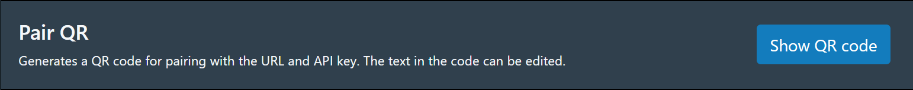
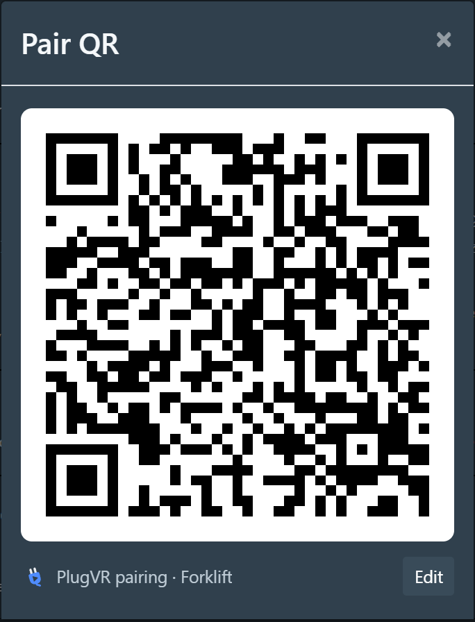
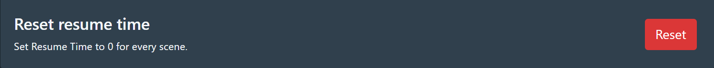
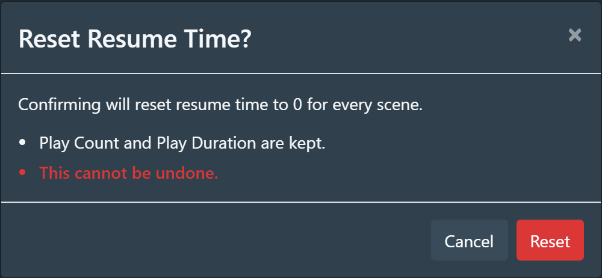

# PlugVR Stash plugins

[Stash](https://stashapp.cc) plugins by PlugVR Studio.

| Plugin | What it does | Requires |
|--------|--------------|----------|
| [Pair QR](plugins/pair-qr) | Shows the server API key as a QR code containing the Stash URL and key, so a mobile or VR app can pair by scanning it. The text in the code can be edited. | Stash v0.27.0 |
| [Reset resume time](plugins/reset-resume) | Sets Resume Time to 0 for every scene. Play Count and Play Duration stay unchanged. | Stash v0.24.3 |

## Screenshots

### Pair QR

In **Settings → Security**, next to the API key. The QR code in the screenshot holds a sample URL and key.

### Reset resume time

In **Settings → Tools**. It asks for confirmation before it runs.

## Install

1. In Stash, open **Settings → Plugins**.
2. Under **Available Plugins**, select **Add source** and enter:
   - **Name:** `PlugVR`
   - **Source URL:** `https://plugvr-studio.github.io/stash-plugins/main/index.yml`
   - **Local path:** `plugvr`
3. Open the PlugVR source, select the plugins you want, then select **Install**.

Each plugin installs and updates on its own. To update, open
**Installed Plugins** and select **Check for updates**.

## Report a problem

Open an issue at
[github.com/plugvr-studio/stash-plugins/issues](https://github.com/plugvr-studio/stash-plugins/issues).

## How publishing works

This repository uses the
[Stash plugins source template](https://github.com/stashapp/plugins-repo-template).
On every push to `main` that changes `plugins/`, GitHub Actions runs
`build_site.sh`, which zips each folder in `plugins/` and writes `index.yml`,
then deploys both to GitHub Pages.

A plugin's id is the name of its `.yml` file (`pair-qr`, `reset-resume`). Stash
installs each plugin into a folder with that name, so do not rename them. Stash
offers an update whenever a plugin folder has a newer commit.

## License

[AGPL-3.0](LICENCE). `plugins/pair-qr/qrcode.js` is the QR Code Generator for
JavaScript by Kazuhiko Arase, licensed under the MIT license.
