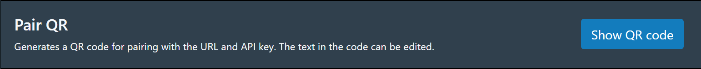
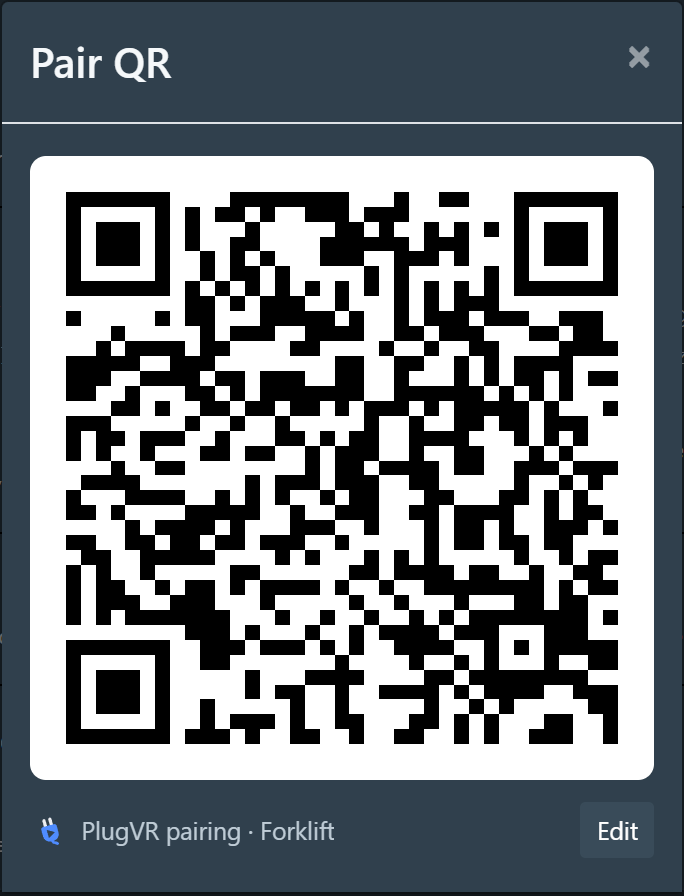
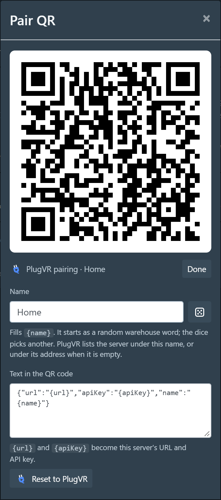

# Pair QR

A [Stash](https://stashapp.cc) UI plugin that shows the server API key as a QR
code containing the Stash URL and key, so a mobile or VR app can pair with the
server by scanning it.

Pair QR appears in **Settings → Security**, next to the API key.





The QR code in the screenshot holds a sample URL and key.

## What the code holds

By default the code holds the JSON that [PlugVR](https://www.meta.com/experiences/1473816599151470/)
reads to pair:

```json
{"url":"{url}","apiKey":"{apiKey}","name":"{name}"}
```

Select **Edit** to set a name or change the text, for an app that expects
something else. When the code is drawn, these placeholders are replaced:

| Placeholder | Becomes |
|-------------|---------|
| `{url}` | The address Stash is open at, such as `http://192.168.1.100:9999` |
| `{apiKey}` | The server's API key, or nothing when Stash has no username and password (see below) |
| `{name}` | What the **Name** field holds: the name PlugVR lists the server under |

The name starts as a random warehouse word, such as `Forklift`, `Pallet Jack`
or `Yard Dog`, one of 50 picked each time the page loads. It shows after
**PlugVR pairing** under the code. The dice button beside the **Name** field
picks another one, never the one already there; or type your own. The name is
optional: while the field is empty, the code uses another random word, shown in
grey in the field.

Everything else is encoded as typed. For example, `{apiKey}` alone gives a code
with only the key. When the text is JSON, the values are escaped as JSON
strings, so a name with quotes in it still gives valid JSON. **Reset to PlugVR**
puts the default text back.



The text and the name are not saved: they stay while the page is open, and
reloading the page brings back the PlugVR text and a new random name.

## Stash opened at localhost

`{url}` is the address in the browser. If Stash is open at `localhost`,
`127.0.0.1` or another address that means "this computer", a headset or phone
reading the code would try to connect to itself. Pair QR shows a warning above
the code then. Open Stash at the computer's network address (such as
`http://192.168.1.20:9999`) and show the code from there, or select **Edit** and
type that address in place of `{url}`. Pair QR checks only the address itself;
it cannot tell what a name such as `mypc` points to.

## Stash without a username and password

A Stash with no username and password answers devices on its own network
without an API key, so Pair QR shows a code without one:

```json
{"url":"{url}","name":"{name}"}
```

A note above it says the code works only on the same network as Stash. To
pair from other networks too, set a username and password under
**Credentials** in **Settings → Security**, then select **Generate API key**:
the code then carries the key. In your own text, `{apiKey}` becomes nothing.

When credentials are removed, Stash keeps the old API key, and that key works
again as soon as any credentials are set. Pair QR leaves it out of the code
too. After setting credentials, generate a new key, which retires the old one.

## Requirements

Stash v0.27.0 or later.

## Install

1. In Stash, open **Settings → Plugins**.
2. Under **Available Plugins**, select **Add source** and enter:
   - **Name:** `PlugVR`
   - **Source URL:** `https://plugvr-studio.github.io/stash-plugins/main/index.yml`
   - **Local path:** `plugvr`
3. Open the PlugVR source, select **Pair QR**, then select **Install**.

To update, open **Installed Plugins** and select **Check for updates**.

## Preview

Open `preview.html` in a browser to check the interface without a running
Stash. It uses sample data, not a real key.

## Third-party code

`qrcode.js` is the QR Code Generator for JavaScript by Kazuhiko Arase,
licensed under the MIT license. "QR Code" is a registered trademark of DENSO
WAVE INCORPORATED.
