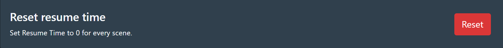
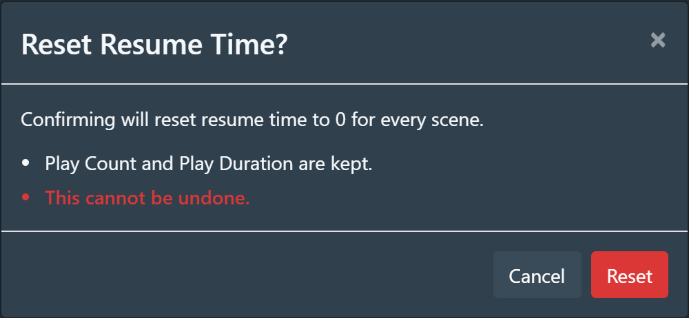

# Reset resume time

A [Stash](https://stashapp.cc) UI plugin that sets Resume Time to 0 for every
scene. Play Count and Play Duration stay unchanged.

The action appears in **Settings → Tools** and asks for confirmation before it
runs. The reset cannot be undone.

## Requirements

Stash v0.24.3 or later.

## Install

1. In Stash, open **Settings → Plugins**.
2. Under **Available Plugins**, select **Add source** and enter:
   - **Name:** `PlugVR`
   - **Source URL:** `https://plugvr-studio.github.io/stash-plugins/main/index.yml`
   - **Local path:** `plugvr`
3. Open the PlugVR source, select **Reset resume time**, then select **Install**.

To update, open **Installed Plugins** and select **Check for updates**.

## Preview

Open `preview.html` in a browser to check the interface without a running
Stash.
